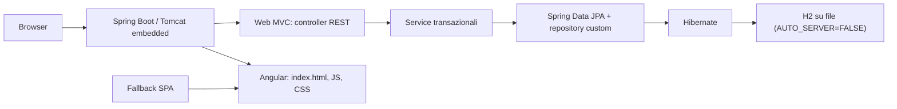

# Architettura generale

Applicazione Angular 22 servita come risorsa statica da un fat JAR Spring Boot 4.1.2. Il JAR avvia Tomcat 11 embedded e usa H2 Embedded su file; non richiede un server Tomcat o database esterno.

## Componenti backend

| Area | Classi | Responsabilità |
|---|---|---|
| Avvio e configurazione | `PrgwebApplication`, `WebConfig`, `application.yml` | Boot, CORS per `http://localhost:4200`, fallback SPA |
| HTTP | `AuthController`, `UtentiController`, `AdminUtenteController`, `GlobalExceptionHandler` | Endpoint invariati e corpi d'errore italiani |
| Dominio | `AuthService`, `UtenteService` | Validazioni, transazioni e invarianti amministrative |
| Persistenza | `UtenteRepository`, `AppLockRepository`, `Utente`, `AppLock` | JPA/Hibernate e lock pessimista sulla riga `app_lock` |
| Schema | Flyway `V1__create_utenti.sql` | Creazione versionata; Hibernate esegue solo `validate` |

Le richieste API sono sotto `/api/**`. Le GET senza estensione fuori da tale prefisso inoltrano la SPA a `index.html`; asset inesistenti e percorsi API mantengono le risposte HTTP previste.

## Registrazione e amministrazione

Le operazioni che decidono il primo amministratore o possono rimuovere l'ultimo acquisiscono `SELECT ... FOR UPDATE` sulla riga permanente di `app_lock`, nella stessa transazione della lettura e scrittura. La sessione è `HttpSession` con cookie `JSESSIONID`; non viene usato JWT.

## Persistenza e operazioni

Il database è H2 Embedded nel percorso `$PRGWEB_DB_PATH/app.mv.db`, aperto da una sola istanza (`AUTO_SERVER=FALSE`). H2 Shell e Restore si eseguono solo dopo la chiusura dell'applicazione. `db-backup.sh` arresta l'app, verifica il processo e lascia il servizio fermo al termine del backup.

Comandi di build, avvio, arresto e backup/ripristino: [build-deploy.md](build-deploy.md) e [database.md](database.md).
